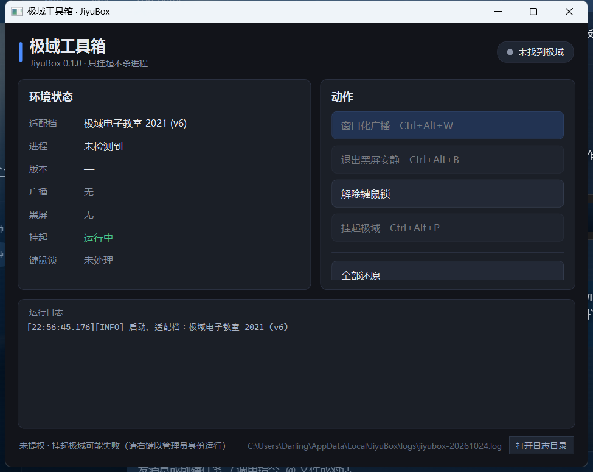

# JiyuBox · 极域工具箱

> 面向极域电子教室（2016 / 2021 v6）学生端的课堂工具箱。
> **只挂起，不杀进程；所有窗口改动都可一键还原。**
> C# / WPF（.NET 8）+ Win32 互操作 · 单文件免安装 · 目标机不需要装 .NET 运行时

---

## 1. 它能做什么

| 功能 | 说明 | 快捷键 |
| --- | --- | --- |
| 环境识别 | 找极域进程、读版本、判断是否正在全屏广播 / 黑屏安静 | — |
| 窗口化广播 | 把全屏广播改成可拖动、可缩放的普通窗口，同时能看老师画面 | `Ctrl+Alt+W` |
| 退出黑屏安静 | 隐藏黑屏窗口并尝试关闭，不结束极域进程 | `Ctrl+Alt+B` |
| 解除键鼠锁 | 高权限反复 `BlockInput(FALSE)` + `ClipCursor(NULL)` 压制 | 按钮 |
| 挂起 / 恢复极域 | `NtSuspendProcess` / `NtResumeProcess`，**不杀进程** | `Ctrl+Alt+P` |
| 全部还原 | 还原窗口样式、恢复进程、停止键鼠解锁 | 托盘菜单 |
| 防截屏 | 本程序窗口对教师端截屏隐身（`WDA_EXCLUDEFROMCAPTURE`，Win10 2004+） | — |

**明确不做**：结束教师端进程、删除极域目录、卸载驱动、注入教师端、任何针对其他同学机器的操作。

---

## 2. 两个版本的包

构建产物在 `dist/`，一共四个目录：

| 目录 | 适用 | 差别 |
| --- | --- | --- |
| `JiyuBox-2016-Portable` | 极域 2016 机房 | 普通置顶，放哪都能跑 |
| `JiyuBox-2021-Portable` | 极域 2021 (v6) 机房 | 同上 |
| `JiyuBox-2016-UIAccess` | 极域 2016 + 需要压过全屏广播 | 需要签名 + 装到 `C:\Program Files` |
| `JiyuBox-2021-UIAccess` | 极域 2021 (v6) + 同上 | 同上 |

- 两个版本的区别只有 `config.json` 里的 `Preset` 和 `adapter.json` 里的进程名，程序完全一样。
- 实际用哪个：**先试 Portable**，如果窗口被极域的置顶压住（点不到按钮），再上 UIAccess 版。

### 2.1 便携版（先试这个）

1. 双击 `JiyuBox.exe`（会请求管理员权限，挂起 SYSTEM 进程必须要）
2. 右上角状态变成「已找到极域」即识别成功
3. 点「窗口化广播」或按 `Ctrl+Alt+W`

### 2.2 UIAccess 版（超级置顶）

UIAccess 是 Windows 的安全机制，三个条件缺一不可，`deploy.ps1` 会一次办完：

1. exe 已签名 → `sign.ps1`
2. 证书被本机信任 → `deploy.ps1` 导入 `LocalMachine\Root` + `TrustedPublisher`
3. exe 在受保护目录 → 复制到 `C:\Program Files\JiyuBox`

```powershell
# 右键「以管理员身份运行」PowerShell
cd dist\JiyuBox-2021-UIAccess
.\deploy.ps1
```

> 没做这三步而直接跑 UIAccess 版，进程会**启动后立刻消失且没有报错**——这是 Windows 的既定行为，不是程序 bug。

---

## 3. 界面



```
┌ 极域工具箱 ────────────────────────── ● 已找到极域 ┐
│ 环境状态                  │ 动作                  │
│  适配档  极域 2021 (v6)   │  [窗口化广播 Ctrl+Alt+W] │
│  进程    StudentMain(4321)│  [退出黑屏安静 Ctrl+Alt+B]│
│  版本    6.0.2021.1       │  [解除键鼠锁]           │
│  广播    正在广播（全屏置顶）│  [挂起极域 Ctrl+Alt+P]  │
│  黑屏    无               │  ─────────────        │
│  挂起    运行中            │  [全部还原]            │
│  键鼠锁  未处理            │                       │
├───────────────────────────────────────────────────┤
│ 运行日志                                           │
│ [22:57:50][INFO] 窗口化广播 → 已窗口化 1344x840 …   │
└───────────────────────────────────────────────────┘
```

---

## 4. 架构

```
JiyuBox.App (WPF, .NET 8)          ← 界面、托盘、热键、状态刷新
        │  同进程调用（无 IPC）
JiyuBox.Core (C#, Win32 P/Invoke)  ← 全部危险动作集中在这里
        ├─ Probe          只读探测：进程 / 版本 / 窗口属性
        ├─ WindowService  窗口化、退出黑屏、还原（记录原始样式）
        ├─ ProcessService 挂起 / 恢复（NtSuspendProcess，绝不 TerminateProcess）
        ├─ InputUnlocker  BlockInput(FALSE) + ClipCursor(NULL) 定时压制
        └─ Native         P/Invoke 表，一个文件看清所有系统调用
```

设计取舍（针对调研里那 5 个项目的坑）：

1. **零注入**：不往极域进程里塞 DLL，不装驱动，全部走公开 Win32 API。
2. **只挂起不杀**：`NtSuspendProcess` 可逆，教师端看到的是画面冻结而不是掉线。
3. **一切可还原**：`WindowService` 保存每个窗口的原始 `style/exstyle/rect`，托盘「全部还原」或退出时恢复。
4. **适配靠数据不靠代码**：进程名写在 `adapter.json`，极域换版本只改配置。
5. **不做自保护**：不挂钩子、不拒绝任务管理器结束，降低杀软误报与“木马特征”。

---

## 5. 配置

`config.json`（与 exe 同目录，首次运行自动生成）：

```json
{
  "Preset": "2021",          // 2016 | 2021，决定默认适配档
  "WindowScale": 0.7,        // 窗口化后占屏幕的比例
  "AutoWatch": true,         // 被极域拉回全屏时自动再压一次
  "StartMinimized": false,
  "ProtectFromCapture": true // 本程序窗口对截屏隐身
}
```

`adapter.json`（首次运行生成，可手改）：

```json
{
  "name": "极域电子教室 2021 (v6)",
  "processNames": ["StudentMain.exe", "StudentDisplay.exe", "TopSrv.exe", "Student.exe"],
  "broadcastHints": ["TD", "Mythware", "Student"],
  "blackScreenHints": ["Black", "ScreenLock", "TDBlack", "Quiet"]
}
```

> 真机上如果识别不到窗口，把日志里的窗口信息（类名/标题/尺寸）发我，我按实际值调 `broadcastHints` 或加一条判定规则。

---

## 6. 构建与测试

```powershell
# 全量构建（四个包）
.\scripts\build.ps1

# 只构建 2021 便携版
.\scripts\build.ps1 -Preset 2021 -PortableOnly

# 单元/冒烟测试（不需要极域、不需要管理员）
dotnet run --project tests\JiyuBox.Smoke -c Release

# 端到端测试（用 FakePeer 冒充极域，验证 探测→热键→窗口化）
.\scripts\e2e.ps1
```

冒烟测试覆盖：窗口识别、窗口化、置顶/全屏还原、`NtSuspendProcess` 挂起后进程仍存活、`NtResumeProcess` 恢复、键鼠锁开关、无目标环境不崩溃。

---

## 7. 已知限制

1. **没有在真实极域上验证过**——本机没装极域。窗口识别用的是通用启发式（全屏 + 置顶 + 无标题栏），逻辑已用假窗口验证，真机可能需要微调 `adapter.json`。
2. **挂起后教师端可能显示掉线**：极域有心跳，挂起太久会被判离线；恢复后一般能自动重连。
3. **UIAccess 需要装自签证书**：这是 Windows 的硬要求，任何 UIAccess 程序都绕不开；学校机器如果有证书策略，需要网管配合。
4. **防截屏只对 Win10 2004+ 有效**，更老系统会显示成黑块。
5. **32 位极域**：本工具是 x64，能挂起 32 位进程；但如果极域是纯 64 位也没问题。

---

## 8. 验证记录

已在本机（Win10 x64 / 1536×960@125%）实际跑过：

| 测试 | 内容 | 结果 |
| --- | --- | --- |
| 冒烟测试 `tests/JiyuBox.Smoke` | 12 项：窗口识别、窗口化、置顶+全屏还原、`NtSuspendProcess` 后进程仍存活、`NtResumeProcess`、键鼠锁开关、无目标环境不崩溃 | 12/12 通过 |
| 端到端 `scripts/e2e.ps1` | FakePeer 冒充极域 → 自动识别 → 全局热键 `Ctrl+Alt+W` → 窗口从 1536×960 全屏置顶变为 1075×672 带标题栏 | 8/8 通过 |
| 打包启动 | `JiyuBox-2021-Portable` 双击启动（自动提权）、窗口标题正确、`exstyle` 含 `WS_EX_TOPMOST` | 通过 |
| 清单校验 | 便携版 `uiAccess=false`、UIAccess 版 `uiAccess=true`、均 `requireAdministrator` | 通过 |
| 签名 | UIAccess 版已自签（未装证书前状态为 `UnknownError`，属预期） | 通过 |

**没验证的**：真实极域 2016 / 2021 环境（本机未安装）、UIAccess 实际压过极域全屏（需装证书 + 装 Program Files）。

---

## 9. 路线图

- **v0.1（当前）**：识别 / 窗口化 / 退出黑屏 / 键鼠解锁 / 挂起恢复 / 全部还原 / 热键 / 托盘 / 防截屏
- **v0.2**：真机适配（2016、2021 各一轮）、黑屏窗口精确识别、多显示器
- **v0.3**：策略还原（注册表快照 + 一键还原）、配置界面、命令行参数（便于机房批量部署）
- **v0.4**：批量部署（静默安装包、启动参数）、日志上报

---

## 9. 免责声明

本工具仅用于**本机课堂环境调节**（把被全屏占用的自己的电脑恢复成可操作状态），不涉及任何其他机器的操作。
请在允许使用的场景下使用；考试、测评等明确要求受控的场合请勿使用。
